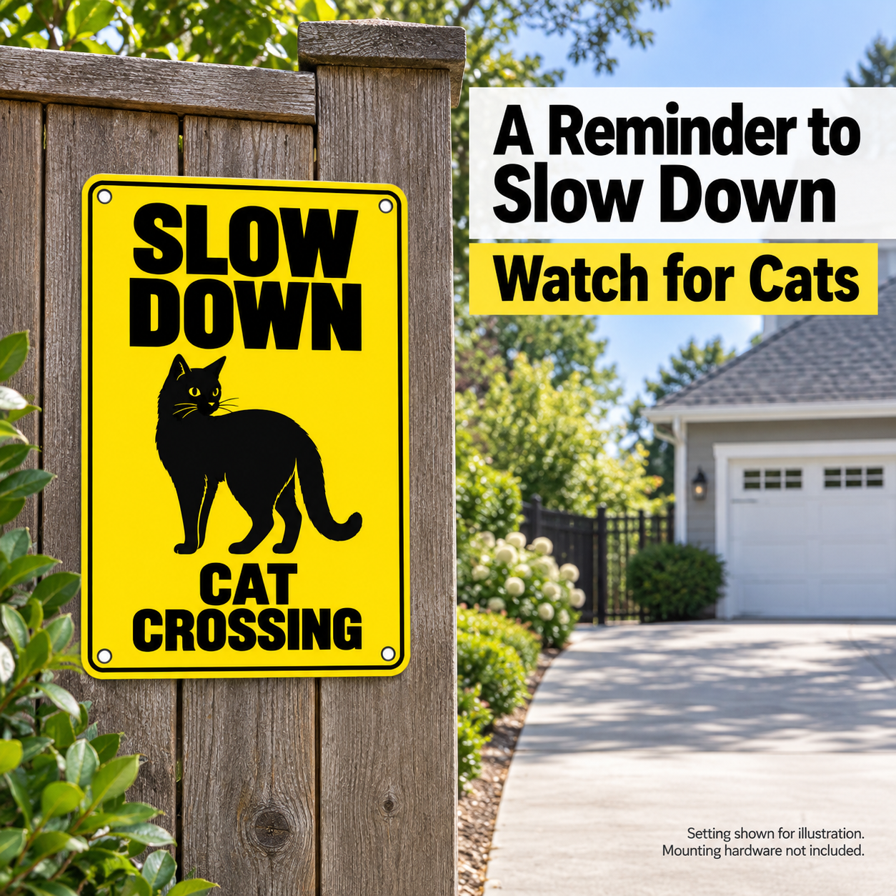
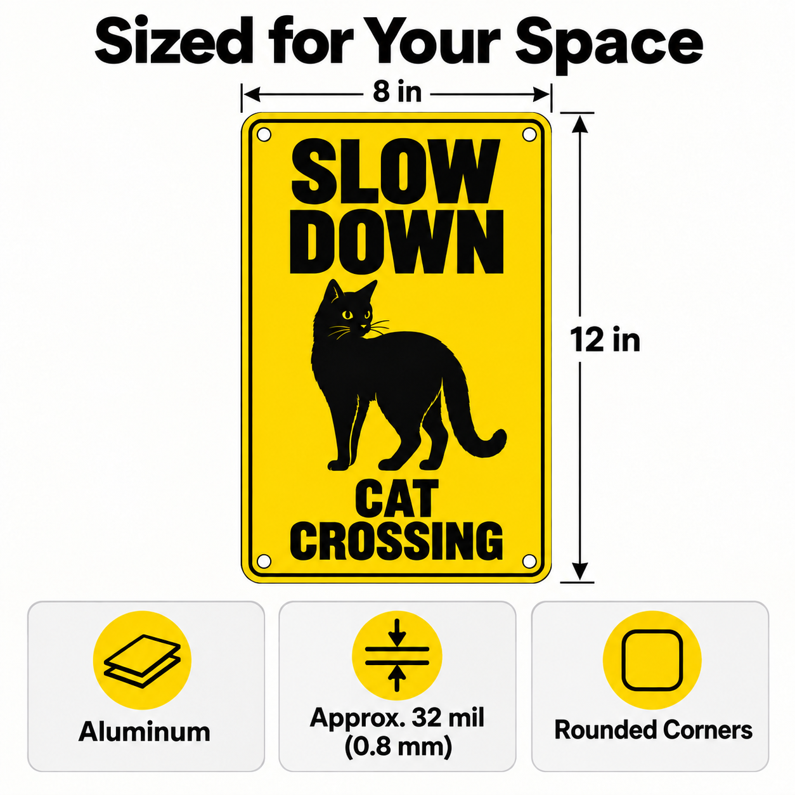
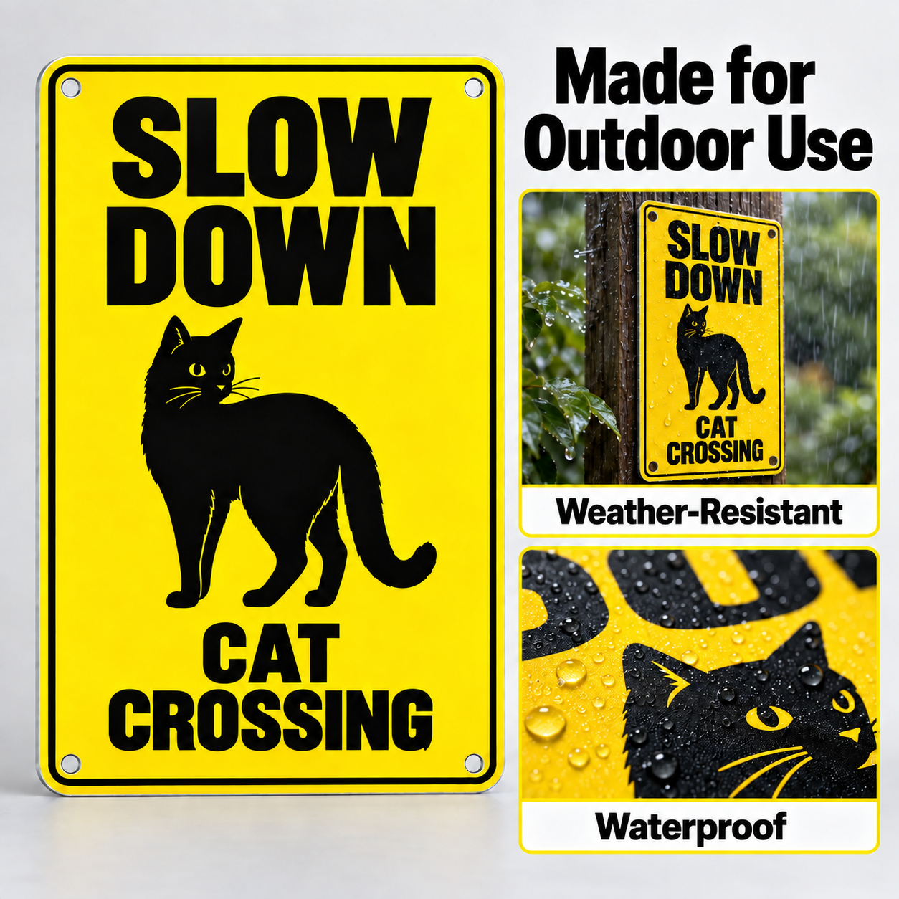
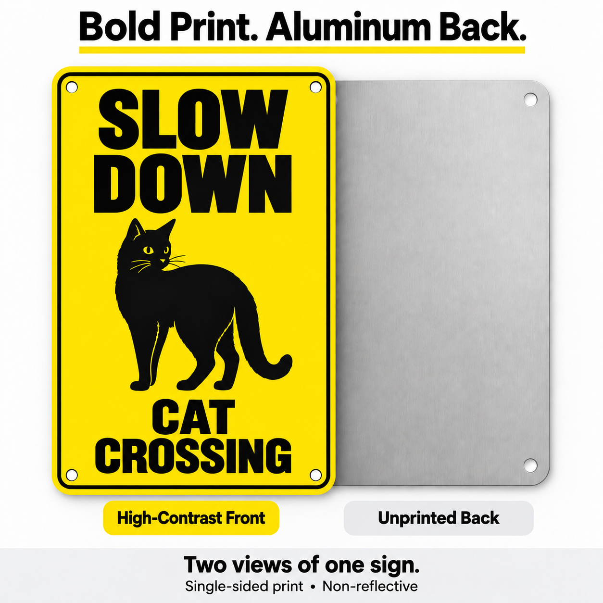
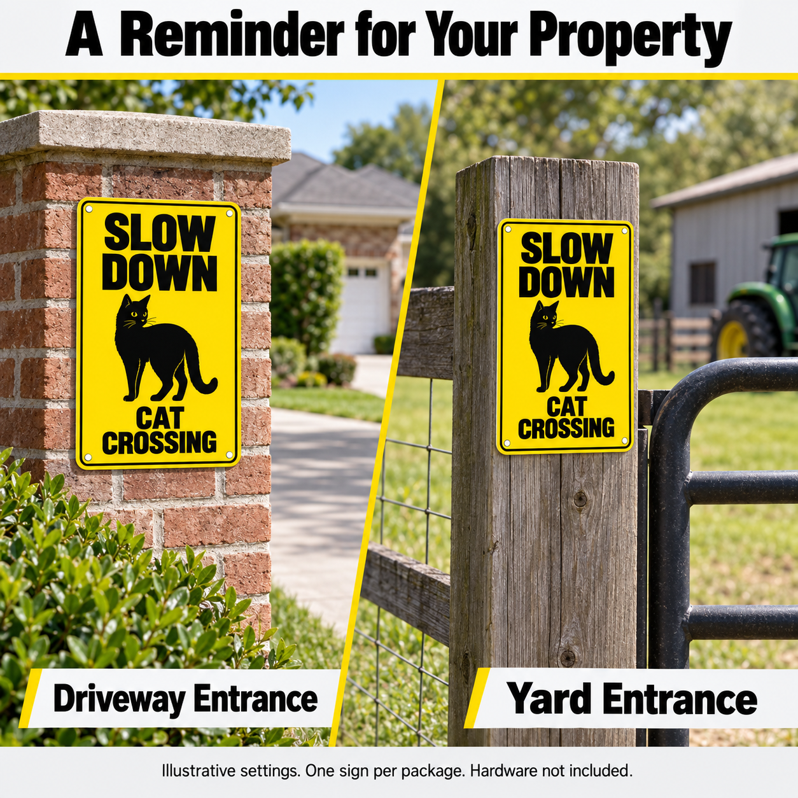
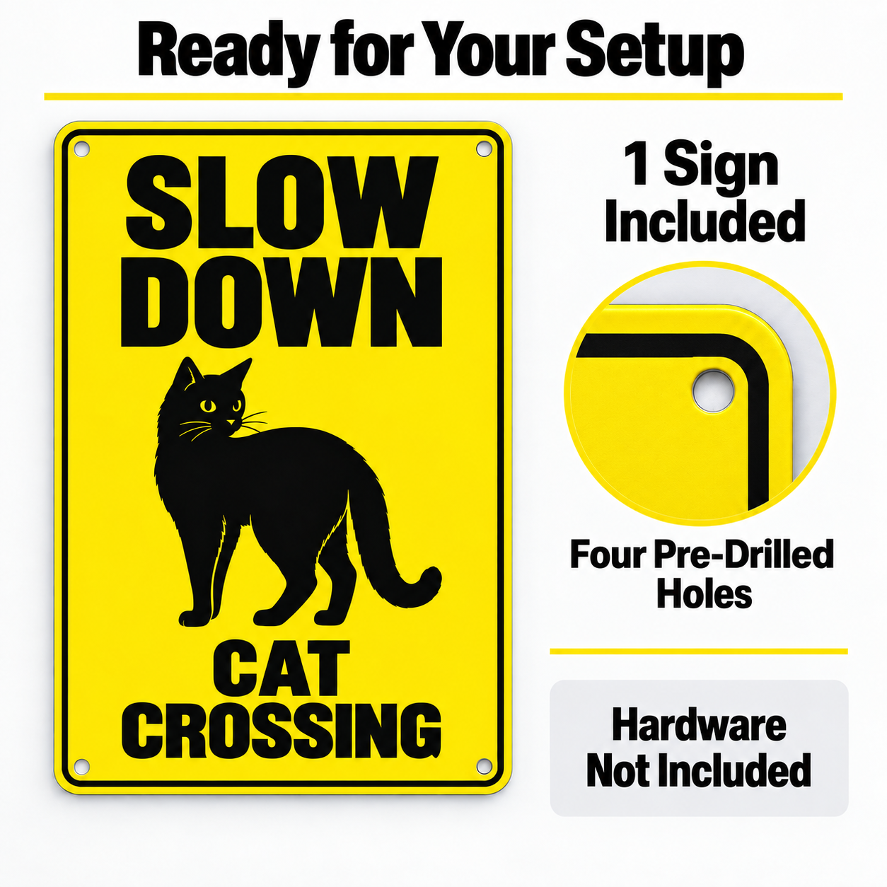

# 铝牌家族副图参考｜SLOW DOWN ANIMAL CROSSING

更新：2026-09-30。用户明确指定以 SLOW DOWN ANIMAL CROSSING 副图替代旧的限速牌/儿童宠物牌默认参考。当前依据为动物铝牌猫款获批6张成图，批准记录：projects/animal-crossing-signs/planning/gallery-reuse-approval.md。

## 复用范围

默认继承下列成图的构图、信息层级和区域组织，可调整颜色、文字、场景、视觉重点、模块数量及比例。参考黄黑配色、猫图案、8×12尺寸、0.8mm、性能、包装内容和1254px原图分辨率都不自动成为其他产品事实或输出规格。每款以当前确认事实与实际比例为准；不得拉伸条形牌。旧项目的尺寸复用特批不自动推广。

这只是版式参考，不代表新产品的牌面、Product Master或最终副图获批。使用已附成图即可，无需访问旧任务。若规划文字与成图不一致，以本文件对获批成图的描述为准（耐候图采用04-fixed照片模块）。

## 默认图序与信息分工

主图独立使用白底商品呈现。以下6张副图按实际信息任务取舍，不为凑数量重复卖点。

| 图位 | 构图与信息任务 | 适配要求 |
|---|---|---|
| 02 场景识别 | 实际场景中产品居左，右上大标题及短强调条；场景清楚且产品比例自然 | 换成本款用途和语句，不复制减速/动物文案 |
| 03 尺寸结构 | 顶部标题、中央产品、贴边宽高线、底部三个卡片 | 材质、确认厚度、圆角；四孔重点移至07，不反光规格移至05 |
| 04 耐候 | 左侧大产品，右上标题，右侧上下两张照片卡：环境雨水与表面水滴细节 | 来源成图为Weather-Resistant与Waterproof。只用当前确认性能；可加简短Rust-Resistant说明或适度调整模块，不强制三图标，不把雨水效果当检测认证 |
| 05 正反面 | 顶部标题，前后视图重叠，下方各自标签，底部说明条 | 明确Two views of one sign；Single-sided print与Non-reflective作规格小字；背面外观按当前参考，不推导拉丝/无涂层工艺 |
| 06 双场景 | 顶部标题，斜线分隔两种实际场景，场景下方短标签，底部必要说明 | 根据本款用途选场景；允许简洁标签，不固定为车道/院门 |
| 07 包装安装 | 顶部标题与分隔线，左完整单片，右上数量、圆形孔位局部、右下附件文字卡 | 本源图是1 Sign Included / Four Pre-Drilled Holes / Hardware Not Included，无螺丝扎带展示；当前产品数量和配件为准 |

## 统一规则

- 保持本款真实颜色、图案、尺寸比例、孔位及数量。黑白灰和粗体层级可继承，强调色按本款协调，不强制黄色或红色。
- 厚度与圆角集中于03，耐候于04，单面及不反光于05，数量/孔位/配件于07。必要的场景配件说明不因去重删除。
- 装饰产品仍以美感和用途优先，不能因为参考是警示牌就改变本款购买意图。
- 不新增反光、抗UV、防褪色、年限、认证、保证安全、免工具或安装兼容性承诺。既有源图不充当其他产品的性能证据。
- 默认包装图不摆出未附配件；场景确需展示安装道具时清晰说明不包含。
- 最终图片按当前项目要求检查分辨率、文字、事实及商品一致性。原参考像素和既有批准不等于新图已合规。

## 获批成图（仅作版式参考）

